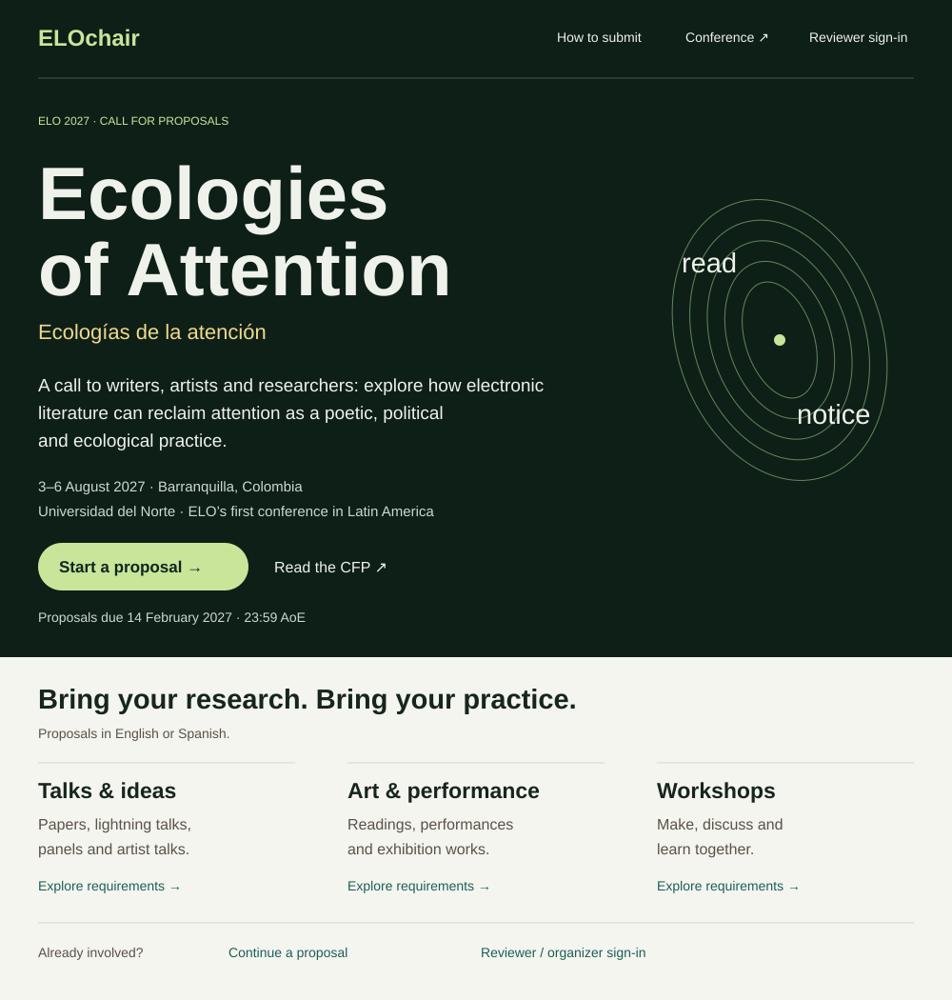
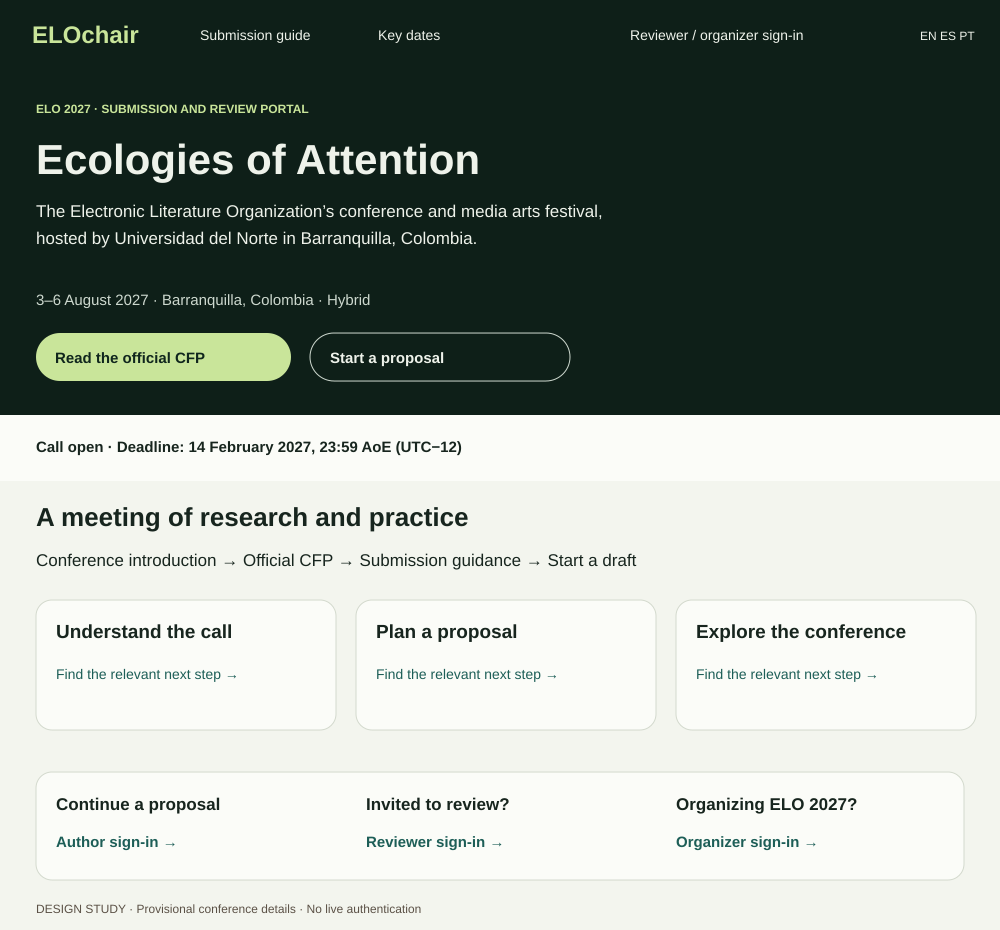
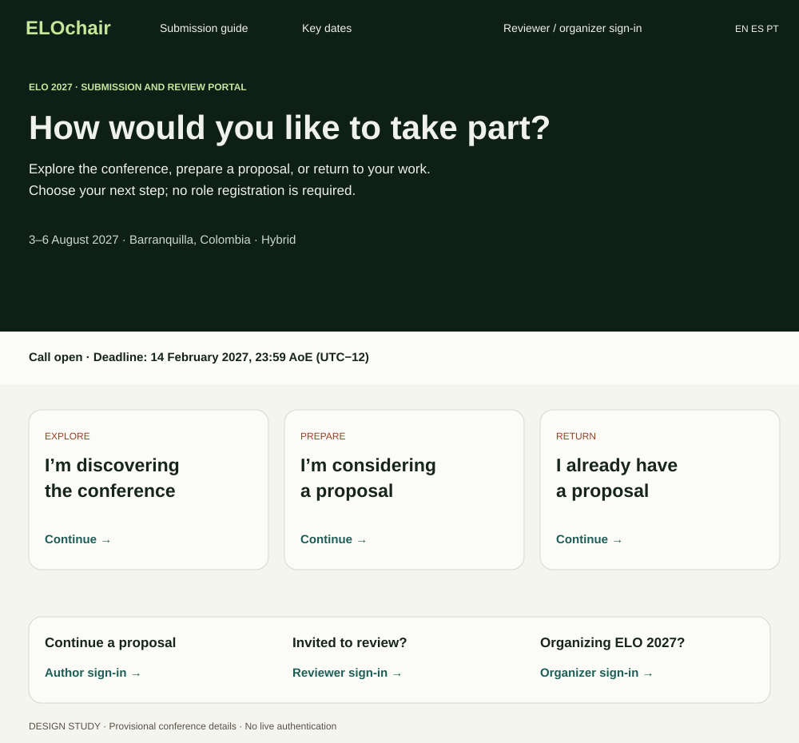

# ELO 2027 submission invitation

The preview now leads with **Ecologies of Attention** and an invitation to writers, artists and researchers. [elo27.eliterature.org](https://elo27.eliterature.org/) remains the conference landing page and the home of the official CFP; ELOchair helps people contribute.

## Revised direction

The opening view explains the theme and the people and work the call welcomes. **Start a proposal** is the main action, with the official CFP beside it and the deadline immediately below. Three compact groups show research presentations, art and performance, and workshops. Requirements sit on a separate page, rather than turning the invitation into a process checklist.

Reviewer sign-in stays in the header. Returning authors and organizers have quieter links below the invitation. All entry points use the same account system; choosing a link does not assign permissions.

The sign-in design preserves the intended next step: a proposal draft, existing proposals, or an invited workspace. This is proposed behavior; the production authentication flow has not been changed.

## Interactive preview

Open [index.html](index.html) on a static web server, or download its raw contents and open the file in a browser. It is self-contained and does not require the API, a login, Codex, or the VM.

The page opens directly on the revised invitation. **Preview options** opens the width and call-state controls at the bottom; they are collapsed by default. The preparation guide, per-format requirements, dates and sign-in paths work inside the preview. The official CFP link opens the existing conference website.

**This is a design study.** Call states are illustrative, and sign-in is a visual endpoint. No email or account data is collected. The preview uses English copy; EN / ES / PT indicate language-switch placement. Production work must use the three typed message catalogs and reviewed translations. Published CFP requirements shown here do not change the app's conference configuration.

The theme summary, first Latin American ELO conference context, submission languages and format requirements were checked against the [conference website source](https://github.com/XehReyes/elo27/blob/d0849861aaa6c8e225364fa3318b7d0870c7c5ff/index.html) on 2026-11-16, alongside [the repository's CFP format record](https://github.com/AMSUCF/ELOchair/issues/14). The summary is new copy based on that source, not a quotation. Curatorial pitches retain their separate email route.

GitHub renders the structure sketches on this page. GitHub's file viewer displays the HTML source rather than executing it. GitHub Pages is currently disabled for this repository; committing this directory alone does not publish a website.

For the existing server at jtm.io, follow [Publish the design preview](../../../deploy/preview.md). That workflow uses GitHub Actions secrets, so it does not require access to Codex environment secrets.

## Earlier structure sketches

The two sketches below document the earlier comparison; the interactive page now focuses on the selected direction.

### Conference front door

Leads with the conference identity and official CFP. It has greater overlap with the existing conference website.

### Visitor pathways

Makes exploring, preparing and returning explicit. The extra choice and amount of copy need testing with unfamiliar visitors.

## Next usability checks

- After a brief first view, describe what the conference is about and who should contribute.
- Find a suitable contribution format and the main action for starting a proposal.
- Find the official CFP and distinguish it from local submission guidance.
- Find the required materials and interpret the deadline in the visitor's time zone.
- Explain the difference between starting a draft and submitting a proposal.
- Find reviewer sign-in without entering the author workflow.
- Explain which email an invited reviewer should use and what grants access.
- Check the same paths on a phone, with keyboard navigation, and across call states.

The structure sketches summarize the layouts; the HTML preview contains the interactive concepts. These are design proposals, not participant test results or a deployed authentication system.
