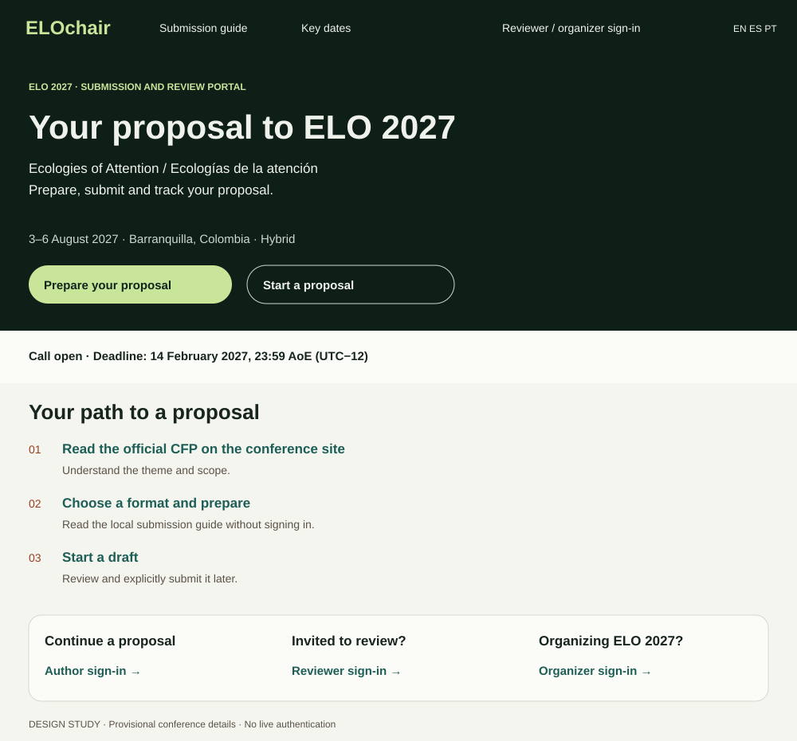
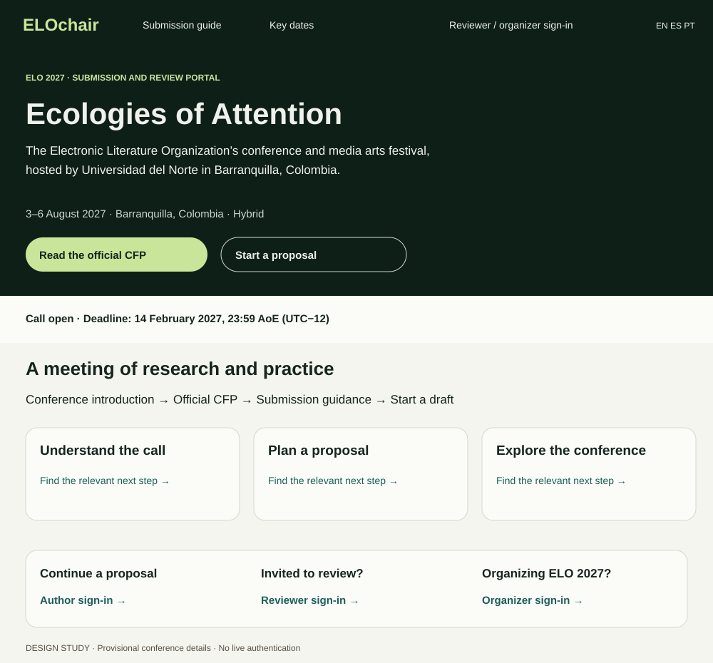
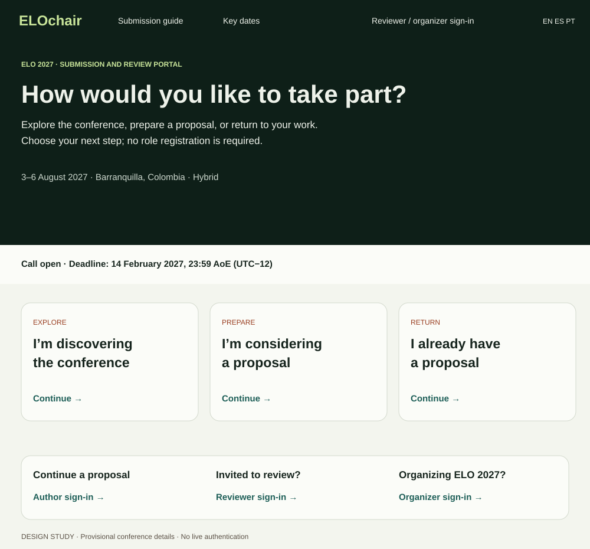

# Visitor design concepts

The selected direction is **Submission companion**: ELOchair is the submission and review portal. [elo27.eliterature.org](https://elo27.eliterature.org/) remains the conference landing page and the home of the official CFP.

## Selected direction: Submission companion

The entry points describe what someone needs to do. Authors can prepare or start a proposal; invited reviewers and organizers can sign in directly. They use the same account system. The link someone chooses does not assign permissions, and someone can have more than one role.

The sign-in design preserves the intended next step: a proposal draft, existing proposals, or an invited workspace. This is proposed behavior; the production authentication flow has not been changed.

## Interactive preview

Open [index.html](index.html) on a static web server, or download its raw contents and open the file in a browser. It is self-contained and does not require the API, a login, Codex, or the VM.

Use the controls at the top to compare all three concepts, switch to a 360 px mobile layout, and inspect upcoming, open and closed call states. The links to preparation, dates and sign-in work inside the preview. The official CFP link opens the existing conference website.

**This is a design study.** The call states are illustrative; dates and formats remain provisional. Sign-in is a visual endpoint. No email or account data is collected. The preview uses English copy; EN / ES / PT indicate language-switch placement. Production work must use the three typed message catalogs and reviewed translations.

GitHub renders the structure sketches on this page. GitHub's file viewer displays the HTML source rather than executing it. GitHub Pages is currently disabled for this repository; committing this directory alone does not publish a website.

## Alternatives retained for comparison

### Conference front door

Leads with the conference identity and official CFP. It has greater overlap with the existing conference website.

### Visitor pathways

Makes exploring, preparing and returning explicit. The extra choice and amount of copy need testing with unfamiliar visitors.

## Next usability checks

- Find the official CFP and distinguish it from local submission guidance.
- Find the required materials and interpret the deadline in the visitor's time zone.
- Explain the difference between starting a draft and submitting a proposal.
- Find reviewer sign-in without entering the author workflow.
- Explain which email an invited reviewer should use and what grants access.
- Check the same paths on a phone, with keyboard navigation, and across call states.

The structure sketches summarize the layouts; the HTML preview contains the interactive concepts. These are design proposals, not participant test results or a deployed authentication system.
