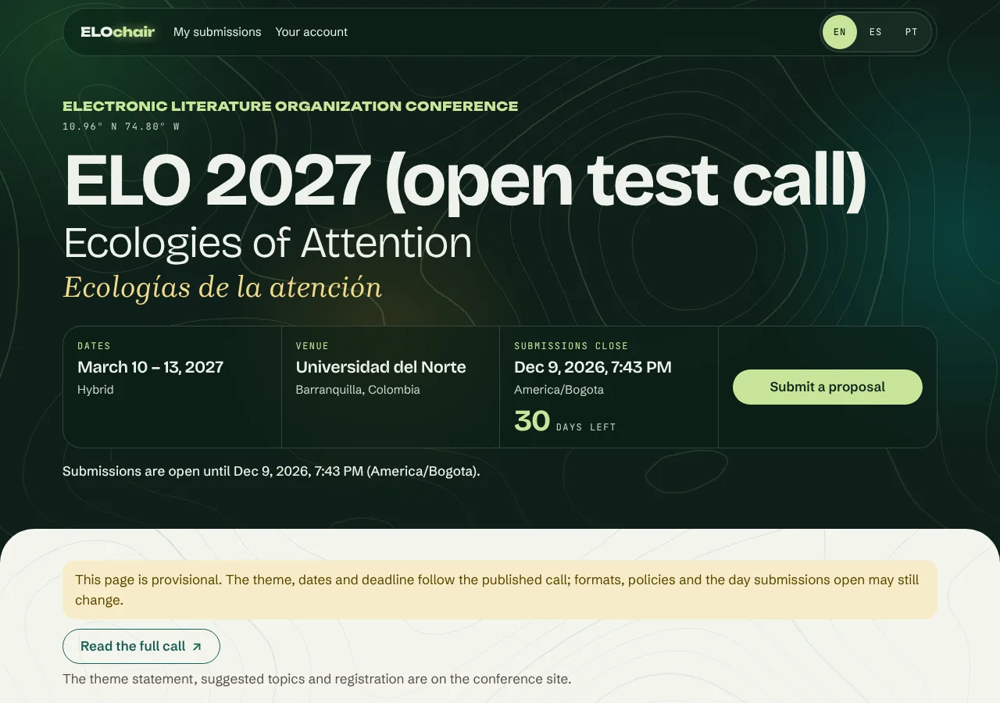
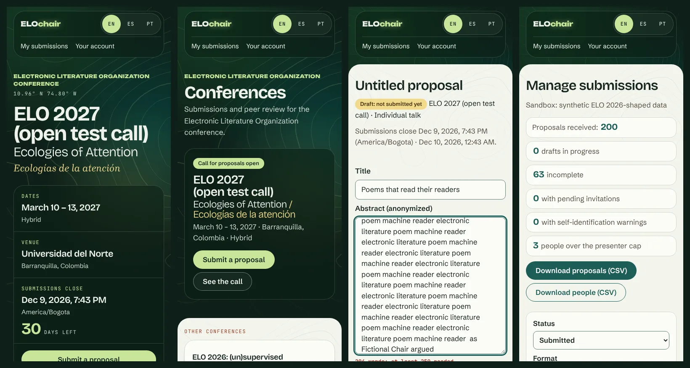
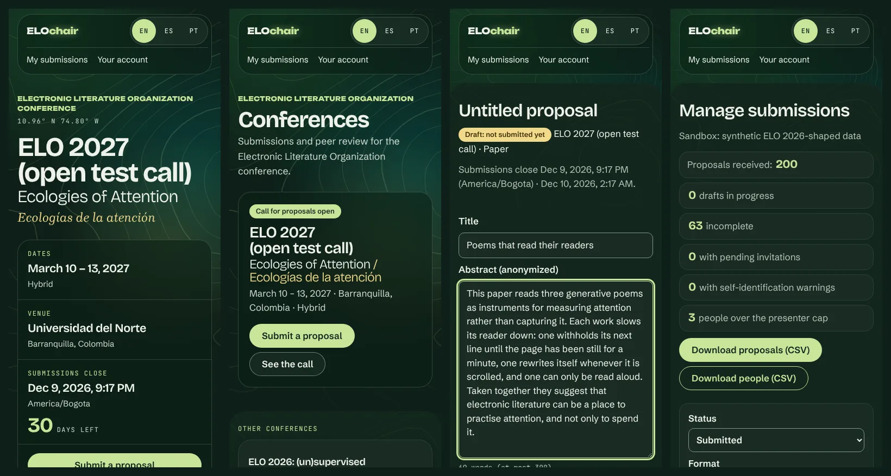

# Visual identity

ELOchair wears the identity of the conference it serves. For ELO 2027 that is "Ecologies of Attention / Ecologías de la atención", as designed for the conference site, <https://elo27.eliterature.org/>. This note says where each part comes from, where it lives in the code, and what to check before changing it.







## Where it comes from

The values below were read from the live conference site on 2026-11-10 by rendering it and inspecting computed styles. Nothing from the site's bundle is copied into this repository: the fonts are the same open-source families, installed from npm, and the artwork is generated here.

| Part | On the conference site | In ELOchair |
|---|---|---|
| Dark sections | Forest green with drifting glow fields and contour lines | The **band**: header, hero and footer |
| Light sections | Paper sheets with a large top radius that slide over the dark | The **sheet**: where pages live |
| Bilingual pairs | `Key dates / Fechas clave`, the second language in rust or gold | The **echo** on public pages |
| Blurred title | "Ecologies of Attention" in and out of focus | The hero title comes into focus once |
| Countdown | Days until submissions close | The same, while the server says the call is open |
| Coordinates | `10.96° N 74.80° W` in mono | From `coordinates` in the conference configuration |
| Title in two weights | "Ecologies" heavy, "of Attention" light and lime | The invitation's headline: the theme's first word, then the rest |

What the front page says, and in what order, follows the design preview in [visitor-preview](visitor-preview/README.md): see "The front page and the invitation" below.

## Code map

```
apps/web/src/styles/
  index.css        import order
  fonts.css        self-hosted fonts (@fontsource)
  tokens.css       every colour, font and radius, for both themes
  base.css         element defaults
  layout.css       shell, band art, header, sheet, footer
  components.css   eyebrow, echo, section head, card, chip, tag, stats, buttons
  forms.css        fields, field sets, errors, filters, the chair's overview
  conference.css   hero, facts strip, formats, timeline, the invitation (home and conference pages)
apps/web/src/assets/contours.svg       generated: do not edit by hand
apps/web/scripts/make-contours.mjs     generates it
apps/web/src/ui.tsx                    Echo, LocalizedEcho, Pair, SectionHeading, Eyebrow, Sheet, Stat, FooterLink
apps/web/src/invitation.ts             when a conference invites, and its main action by the state of its call
apps/web/src/invitationParts.tsx       InvitationHero, WaysToContribute, AlreadyInvolved
apps/web/src/App.tsx                   Shell, BandArt, Wordmark
apps/web/e2e/identity.spec.ts          the checks described under "Promises"
```

## Themes and tokens

Two themes follow the system setting (`prefers-color-scheme`). Colours are named in `tokens.css` and nowhere else; components use the role tokens, never the palette directly.

| Role token | Paper (light) | Forest (dark) | Used for |
|---|---|---|---|
| `--bg` | paper `#f3f5ee` | `#12261d` | the sheet |
| `--surface` | `#fbfcf8` | `#1a2c24` | cards, fields |
| `--sunken` | `#e7ece0` | forest `#0e1f18` | quiet chips |
| `--text` | ink `#17251e` | mist `#eef2ea` | text |
| `--muted` | taupe `#5b5146` | `#b4c2b6` | secondary text |
| `--accent` / `--accent-text` | teal `#1d5e57` / white | lime `#c9e59a` / `#10261d` | buttons, links |
| `--echo`, `--label` | rust `#9a3f22` | gold `#f0d98a`, lime | the echo, mono labels |
| `--numeral` | teal | lime | large numbers, section numbers |
| `--line` / `--control-border` | `#d3d9cd` / `#5f7a72` | `#2c4036` / `#7d9488` | hairlines / field borders |
| `--danger` / `--danger-text` | `#a3261b` / white | `#ffb4ab` / `#2b0f0b` | destructive actions, errors |
| `--notice-bg` / `--notice-text` | `#f6ecc9` / `#5c4400` | `#33300f` / `#fbe7a6` | notices |

The band is forest in both themes and has its own tokens (`--band-bg`, `--band-text`, `--band-muted`, `--band-accent`, `--band-echo`). Inside `.hero`, `.site-header` and `.site-footer` the role tokens are re-pointed at the band's values (top of `conference.css`), so a button, link, eyebrow or chip placed there needs no special case.

## Type

All five families are under the SIL Open Font License and are bundled from `@fontsource` packages, so no request leaves the app's origin.

| Token | Family | Used for |
|---|---|---|
| `--font-display` | Bricolage Grotesque (variable) | headings, large numerals, facts |
| `--font-sans` | Schibsted Grotesk (variable) | interface and body text |
| `--font-serif` | Brygada 1918 (variable, roman and italic) | the lede, submitted abstracts shown for reading, the hero's echo |
| `--font-mono` | JetBrains Mono (variable) | uppercase micro-labels, coordinates, section numbers, word counts |
| `--font-mark` | Unbounded 800 | the wordmark and the hero eyebrow |

A first visit to the front page (while it is a dressed conference's invitation) or to that conference's page fetches five font files, 175 kB in all: the wordmark face, the interface face, the display face, the mono face and the serif italic. The app's own pages wear no identity and fetch none. Each file is fetched only when a page uses its face and character range. Reducing this is tracked in the repository's issues ("Font loading: preload, fallback metrics and a payload budget").

## Layout

- **Shell** (`Shell` in `App.tsx`): the band art, the header, `<main>`, the footer.
- **Ordinary pages** are the sheet: `<main class="sheet">`. Content is centred at `--content` (46rem) by padding, so pages need no wrapper.
- **Hero pages** (home and a conference's page, listed in `hasHero()` in `App.tsx`) render a `<header class="hero">` on the band and then their own `<Sheet>`. Use `<Sheet wide>` for the 70rem width.
- **To add a hero page:** add its route to `hasHero()`, and make every return path of the page render inside a `Sheet`, or text will sit in light colours on nothing.

## The front page and the invitation

The front page features one conference: the one whose call is open, else the one furthest from the archive. What it is then depends on that conference's configuration, never on its slug (spec 02, §1.10).

- **A conference that invites** has an invitation, a line about what sets the edition apart, or ways to contribute in its configuration. The front page is its invitation, and its own page begins with the same one. The parts and their order are those of the design preview's opening view:
  1. **On the band** (`<InvitationHero>`): the conference's title and the state of its call as the eyebrow; the theme as the headline, with its echo; the main action; the dates, place, host and the line about the edition; then on glass the invitation, the link to the full call and when proposals are due.
  2. **On the sheet**: "Ways to contribute" (`<WaysToContribute>`), a card for each group of formats with a link to them on the conference page; "Already involved?" (`<AlreadyInvolved>`); and on the front page the other conferences as compact cards.
  3. **In the footer**: the conference's website (`<FooterLink>`), beside the app's own link.
- **The conference page adds** what it always showed: the coordinates, the days left while the call is open, "Manage submissions" for its chairs, and after the ways to contribute its formats and deadlines.
- **Which identity.** A conference's page is dressed by its slug (`data-dressed` on `.shell`). The front page has no slug, so it says itself whose identity it wears: `data-dressed` on `.home`, which the `:has()` selector in `tokens.css` picks up. It does so only while it is the invitation of a conference that has an identity.
- **A conference that does not invite** is shown as before: on the front page a card on glass (`.feature`) under the heading "Conferences", in the plain look; on its own page its title as the heading and the facts strip.
- **Two phones, one layout.** On a phone the parts stack in the order above, with the main action straight under the headline. From 52rem the band has two columns: the headline, the action and the place on the left, the glass card on the right.

## Components

| Class or component | What it is | Notes |
|---|---|---|
| `.eyebrow`, `<Eyebrow>` | mono uppercase micro-label | also styles `dt` in `.details` |
| `.echo`, `<Echo>`, `<LocalizedEcho>` | the second language of a pair | always `aria-hidden`; see "Promises" |
| `.echo-below`, `<Pair>`, `.pair` | the echo on a line of its own under its text, without the slash | for a sentence or the label of a button; `<Pair>` is an interface text with its echo |
| `a.paired` | a link that holds a pair | only its text is underlined, not the echo |
| `.section-head`, `<SectionHeading>` | numbered `h2` with echo and a hairline | public pages only |
| `.card` | surface panel with a large radius | titles inside are `h2`/`h3` links |
| `.badge` | status chip | tones: `data-tone="good" \| "warn" \| "info"`, or `status-*` classes; default is quiet. A conference's chip says its phase, except that "Call for proposals open" is said only while the call is open (`chipKey()` in `labels.ts`) |
| `.tag` | outlined mono chip | review pool on a format card |
| `.stats`, `<Stat>` | stat tiles: value over label | read as one phrase ("250–300 words") |
| `.overview` | the chair's figures | the number is set large inside its sentence |
| `button`, `.button` | pill; `.secondary`, `.danger` | 44px tall at least |
| `.notice` | pale gold panel | for things to know, not errors |
| `.timeline` | key dates | vertical on a phone, horizontal from 52rem; `li.key` is filled in |
| `.format`, `.format-elsewhere` | a format card; dashed for a format the call takes outside this portal | conference page |
| `.hero-facts`, `.fact`, `.countdown` | the facts strip on glass | conference page |
| `.feature` | the featured conference on glass | home page, for a conference that does not invite |
| `.invitation`, `<InvitationHero>` | the top of an invitation, on the band | front page and conference page |
| `.headline`, `.headline-lead`, `.headline-rest` | the theme as the `h1`: first word heavy, the rest light and in the accent colour | `.headline.long` sets a theme that is a sentence as prose |
| `.invitation-event` | dates, place, host and the line about the edition | quiet lines under the main action |
| `.invitation-card`, `.invitation-text`, `.invitation-due` | the glass card: the invitation, the full call, when proposals are due | the due date links to the deadlines |
| `.ways`, `.way`, `<WaysToContribute>` | "Ways to contribute": a card for each group of formats | each links to its first format (`#format-<key>`) |
| `.involved`, `<AlreadyInvolved>` | "Already involved?": the ways back in, under a hairline | a `nav`; everyone signs in the same way |
| `.footer-slot`, `<FooterLink>` | a page's own link in the footer | the conference's website |

Chip tones come from `phaseTone()` and `contribTone()` in `labels.ts`. The chip's text always carries the meaning; the tone only supports it.

## Motifs

- **Contour lines.** `contours.svg` is drawn by `apps/web/scripts/make-contours.mjs` from a made-up height field (marching squares, then smoothing). It is used as a CSS mask, so the lines take the colour of the theme (`--band-contour` on the band, `--contour` on the sheet). To change the pattern, edit the script and run it; the output is deterministic.
- **Glow fields.** Three radial gradients drift slowly behind the header and hero (`.glow-*` in `layout.css`). Their strength is capped: see "Promises".
- **Coming into focus.** The hero's `h1` sharpens from a blur once, in 1.1 seconds. Only `filter` animates, never opacity, so text is never faint.
- **The echo.** English and Spanish are the conference's two languages. In English and Portuguese the echo is Spanish; in Spanish it is English (`partnerLang()` in `ui.tsx`). Conference text gets an echo only when the configuration has that language. After a heading it follows on the same line, behind a slash. Under a sentence or in a button it has a line of its own (`below`), as on the invitation, where every text is paired.
- **The headline in two weights.** On an invitation the theme is the `h1`, its first word in weight 700 and the rest in weight 300 and the accent colour, after the conference site's title. A theme longer than 48 characters is a sentence, and is set as prose instead.
- **The wordmark.** `ELO` plus `chair` in the accent colour with a soft glow, after the `ELO27` mark. It is one inline element so that it is read as one word.

## Promises

These are checked by `apps/web/e2e/identity.spec.ts`, and the last one by `smoke.spec.ts`. Each was shown to fail when broken on purpose.

1. **Contrast on the band.** Text sits directly on the glow fields, where axe cannot measure. On the conference page and on the front page, the test first checks that every text in the hero is in one of the four band colours (text on a filled button aside, which axe measures). It then screenshots the art alone at six points of its drift, finds the brightest pixel, and requires 4.5:1 against it for every band text colour. Measured at the brightest point (`#376146`): mist 6.26, band-muted 4.83, lime 5.12, gold 5.07. On the glass panels the lowest is 8.55. **Do not raise the `--glow-*` alphas or `--band-contour` without running this test.**
2. **Contrast elsewhere.** axe runs in both themes on every page the e2e suite visits. Measured pairs:

   | Pair | Paper | Forest |
   |---|---|---|
   | text on sheet / on surface | 14.48 / 15.44 | 14.03 / 12.96 |
   | muted on sheet / on surface | 7.05 / 7.52 | 8.58 / 7.93 |
   | accent as text on sheet / on surface | 6.85 / 7.30 | 11.48 / 10.60 |
   | text on an accent button | 7.52 | 11.51 |
   | echo and labels on sheet / on surface | 6.15 / 6.56 | 11.36 / 10.49 |
   | danger text on sheet / text on a danger button | 6.70 / 7.37 | 9.37 / 10.52 |
   | notice text | 7.78 | 10.88 |
   | field border on sheet / on surface (needs 3:1) | 4.23 / 4.52 | 4.89 / 4.52 |
   | chips: good / warn / info / quiet | 11.48 / 9.74 / 7.52 / 6.45 | 11.48 / 9.74 / 4.88 / 6.61 |

   The palette also has colours the app does not use yet (the site's ochre `#8a6512` and coral `#e8735a`). Ochre measures 4.84 on paper, enough for text; coral measures 2.72, so it could only ever be decoration.

3. **Touch targets.** The wordmark, both navigation links, the three language links (44px wide as well) and the footer link are at least 44px tall at 360px wide, with no sideways scrolling. So is every link of an invitation: its two buttons, the due date, the ways to contribute, the ways back in and the conference's website.
4. **Motion is opt-in.** Every animation and transition sits inside `@media (prefers-reduced-motion: no-preference)`. With reduced motion, `document.getAnimations()` is empty. Without it, only the glow fields and the hero title animate.
5. **Nothing from elsewhere.** No request leaves the app's origin, and nothing is refused by the Content-Security-Policy. Vite is configured never to inline assets (`assetsInlineLimit: 0`), because an inlined font is a `data:` URL, which the policy blocks.
6. **The echo is not read twice.** It is `aria-hidden` with its own `lang`; headings are named in the page's language only.
7. **The device clock decides nothing.** The countdown is shown only while the server says the call is open, and is for display only (spec 02 §1.3). Whether an invitation says "Call for proposals", "Call opening soon" or "Submissions closed", and which main action it offers, is the server's answer too (`callState`, which has unit tests for all three; the seeded call is open, so the browser tests see that one; spec 02 §1.10).
8. **A deadline reads as its call states it.** Where the pages show a deadline, they show the date and time as written and name the clock: the conference's time zone, "anywhere on Earth (AoE)" for an offset of −12:00, or the offset itself (`statedDeadline`; spec 02 §1.10). The open call closes anywhere on Earth: the tests hold the invitation and the timeline to that, and ELO 2026's page to its own time zone, as before.

## Do and do not

- **Do** add a colour as a token in both themes, then measure it against the backgrounds it will sit on.
- **Do** put new strings in all three catalogs; the echo comes from the catalogs, so it needs no extra text.
- **Do not** write a colour, font family or radius in a component file.
- **Do not** put text on the band in a colour other than the four band tokens.
- **Do not** add an animation outside the `no-preference` media query, or animate opacity on text.
- **Do not** use the echo in forms or on working pages: there it is noise.
- **Do not** decide what a page shows of a conference by its slug. Its configuration says what it has; only the identity goes by `dressedAs()`.
- **Do not** fetch fonts or images from another origin.

## Next year

The identity belongs to ELO 2027. For another conference, most of the change is in `tokens.css` (palette and fonts), `make-contours.mjs` (or another motif) and the wordmark. The layout, components and promises should carry over unchanged.
